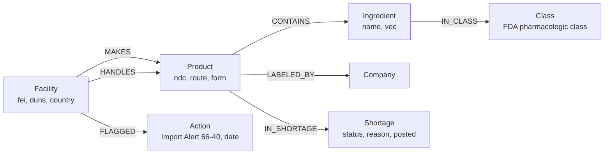
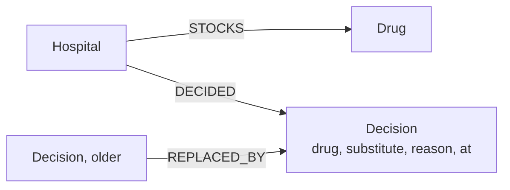

# Provenance

When a drug runs short, a hospital pharmacist picks a substitute. Provenance checks whether that substitute is made in the same plant as the drug that ran out, using a FalkorDB graph built from FDA public records, and an agent that answers from the graph.

Demo video: _link added after recording_ · Live app: _link added after deploy_ · Tracks: Agents That Act on Connected Data, Agent Memory and Coordination

## The problem

In November 2022 FDA inspectors found shredded quality records at an Intas Pharmaceuticals plant in Sanand, Gujarat. That plant made over half of US generic cisplatin and carboplatin, two chemotherapy drugs. Intas stopped US production, cisplatin went short in February 2023, and FDA put the plant on Import Alert 66-40 on 1 June 2023. In a June 2023 survey of 27 US cancer centres by NCCN, 93% were short of carboplatin and 70% of cisplatin.

Carboplatin is the textbook substitute for cisplatin. It came out of the same plant.

That failure repeats. ASHP counted 227 active US drug shortages in Q2 2026, and 48% of new 2026 shortages were sole-source. Search tools that pick a substitute by how similar its label reads cannot see a shared plant, because no single document says "these two drugs share a factory". The connection exists only across records: a label names a plant, the plant has an FDA number, the FDA number is on an import alert.

## What it does

- Check a substitute: pick a drug. The page shows the substitute a label-text search would suggest next to what the graph says about it: which manufacturing plants the two drugs share, and whether any of those plants is under an FDA import alert. Then the same-class drugs that share no plant with it.
- Ask the agent: a pharmacist asks in plain English. Claude Opus 5.5 picks graph queries as tools, and every plant, FEI number and date in its answer comes from a tool result. The page lists each tool call with its Cypher.
- Hospital memory: each hospital is its own FalkorDB graph on the same server. It records what the hospital stocks and every substitution it decided, with the earlier decision kept and linked to the one that replaced it. When the pharmacist says "we switched cisplatin to oxaliplatin", the agent records it and warns that oxaliplatin also comes out of the Intas plant.
- If a plant stops: pick a plant. The page lists every drug that depends on it, and reads the same event through each hospital's memory graph. One FDA action on the Intas plant hits three stocked drugs at the oncology centre, dexmedetomidine at the surgical hospital, and furosemide at the children's hospital.
- Where the risk sits: plants ranked by how much of today's shortage drugs they carry.

The three hospitals are synthetic demo tenants. Every drug, plant and FDA action they point at is a real record.

## Results

`provenance eval` asks the same question for every drug on the current FDA shortage list that the graph covers: take the substitute whose label text is most similar (bge-small embeddings in a FalkorDB vector index), then check it against the graph.

| Measure | Count | Share |
|---|---|---|
| Drugs on the current shortage list evaluated | 18 | |
| Similar-text substitute shares a manufacturing plant with the drug in shortage | 14 | 78% |
| Similar-text substitute is itself on the shortage list | 6 | 33% |
| Similar-text substitute shares a plant under FDA Import Alert 66-40 | 1 | 6% (carboplatin and cisplatin, through Intas) |
| Graph found a same-class substitute with no shared plant | 15 | 83% |

Where the similar-text pick shared no plant: dextrose (picked norepinephrine), dopamine (mexiletine), hydromorphone (tramadol), lorazepam (chlordiazepoxide). Where the graph found no plant-independent option: carboplatin, dextrose, rocuronium. Full table with plant names: [eval/results.md](eval/results.md).

"Shares a plant" counts only plants a label names for manufacture or sterilisation. Repackers and relabellers are stored on a separate `HANDLES` edge and kept out of every count; before that split, the shared-plant rate read 94%, which overstated it.

## How it works

1. `provenance build` pulls the FDA shortage list (1,585 rows) and picks scope: the 20 substances with the most current shortage rows plus the three platinum drugs, then up to 8 members of each of their 14 FDA pharmacologic classes as candidate substitutes. 75 substances in all.
2. For those substances it reads 6,251 single-ingredient products from openFDA NDC, then the 3,828 DailyMed labels behind them. Each label lists the plants that make, test, pack or relabel the product, with a DUNS number and the product codes each plant handles. All 3,828 labels were read; none were skipped.
3. The FDA establishment registry (10,438 plants) maps each DUNS to an FDA FEI number and a country. Import Alert 66-40 (471 firms) is matched to registry plants by firm name, country and address words; a firm with several sites (Intas has seven) is matched to the one address it names.
4. `provenance load` writes it all into FalkorDB and embeds each drug's "Indications and usage" label text into a FalkorDB vector index for the baseline.
5. The web app and the agent run the queries below. With no API key the agent replays recorded answers, or falls back to a rule-based planner that runs the same tools; the page says which mode answered.

## Graph model



Each hospital tenant is a separate graph named `hospital:<slug>`:



| | Count |
|---|---|
| Products | 6,251 |
| Plants | 324 |
| `MAKES` edges (manufacture, sterilise) | 2,498 |
| `HANDLES` edges (pack, relabel, test) | 6,821 |
| Product to shortage links | 2,877 |

## The Cypher the product depends on

The substitute trap: same-class substitutes and the plants they share with the drug in shortage, with any FDA action on those plants. Five hops in one pattern.

```cypher
MATCH (i:Ingredient {name: $drug})-[:IN_CLASS]->(c:Class)<-[:IN_CLASS]-(alt:Ingredient)
WHERE alt <> i
OPTIONAL MATCH (i)<-[:CONTAINS]-(p:Product)<-[:MAKES]-(f:Facility)-[:MAKES]->(q:Product)-[:CONTAINS]->(alt)
OPTIONAL MATCH (f)-[:FLAGGED]->(a:Action)
WITH alt, c, f, collect(DISTINCT a.type + ' ' + a.date) AS flags,
     count(DISTINCT p) AS orig_products, count(DISTINCT q) AS alt_products
RETURN alt.name AS substitute, c.name AS class,
       collect(CASE WHEN f IS NULL THEN NULL ELSE {plant: f.name, fei: f.fei, country: f.country,
               flags: flags, orig_products: orig_products, alt_products: alt_products} END) AS shared_plants
```

Plant down: every drug a plant manufactures, its share of US labels, and whether it is short now.

```cypher
MATCH (f:Facility {fei: $fei})-[:MAKES]->(p:Product)-[:CONTAINS]->(i:Ingredient)
OPTIONAL MATCH (p)-[:IN_SHORTAGE]->(s:Shortage {status: 'Current'})
OPTIONAL MATCH (i)<-[:CONTAINS]-(other:Product)
WITH f, i, count(DISTINCT p) AS from_plant, count(DISTINCT other) AS all_products, count(DISTINCT s) AS short_now
RETURN f.name AS plant, i.name AS ingredient, from_plant, all_products,
       round(100.0 * from_plant / all_products) AS share_pct, short_now
```

Bridging plants: exact betweenness centrality (FalkorDB `algo.betweenness`) on a plant-drug projection, where `(Facility)-[:SUPPLIES]->(Ingredient)` and `(Ingredient)-[:DEPENDS_ON]->(Facility)` exist for every plant that makes a drug. A high score means many drug-to-drug supply paths run through the plant, so its failure spreads across drug classes. Fresenius Kabi (FEI 3001833549) makes 15 of the graph's drugs across 14 classes. Intas ranks 33rd: a single point of failure for platinum drugs, not a bridge between classes.

```cypher
CALL algo.betweenness({nodeLabels: ['Facility', 'Ingredient'], relationshipTypes: ['SUPPLIES', 'DEPENDS_ON'],
                       samplingSize: $nodes, samplingSeed: 7})
YIELD node, score
WHERE node:Facility AND score > 0
```

Safe substitutes: same class, no shared manufacturing plant, ranked by whether they are short and whether a flagged plant makes them. The baseline uses FalkorDB's vector index:

```cypher
MATCH (i:Ingredient {name: $drug})
CALL db.idx.vector.queryNodes('Ingredient', 'vec', $k, i.vec) YIELD node, score
WHERE node <> i
RETURN node.name AS substitute, score
```

All queries live in [src/provenance/queries.py](src/provenance/queries.py); the chokepoint ranking and the hospital-memory queries are in the same folder.

## What broke and how it was fixed

- Repackers looked like factories: labels list repackers and relabellers next to manufacturers. Counting them made the shared-plant rate 94%. Split into `MAKES` and `HANDLES`; the honest rate is 78%.
- Two Intas sites, two dates: the first matcher attached both Intas import-alert entries (June and November 2023) to one plant. The November entry belongs to a different site (FEI 3003157498). The matcher now scores every registered site of the firm by shared address words and takes the best one. A test pins this.
- DailyMed rate limits: the first full pull died on HTTP 429 at label 1,739. The fetcher now paces DailyMed to one request every 0.35 s, honours `Retry-After`, and records every response so a rerun resumes.
- Betweenness was sampled: `algo.betweenness` starts from 32 sampled nodes by default, so its scores are estimates. Setting `samplingSize` to the node count (398) makes them exact. Even exact, FalkorDB 4.22 and 6.0.1 return different scores on the same 671 edges; both put the same three plants on top (APL Healthcare, Fresenius Kabi FEI 3001833549, West-Ward Columbus) in a different order. The live app runs on FalkorDB Cloud (4.22). A test checks the top three on both.
- Combination products pulled in unrelated classes: dextrose combinations dragged heparin into scope. Scope now uses single-ingredient products only.

## Known gaps

- Labels name the plant that makes the finished drug, not the plant that makes the active ingredient. Many shortages start at the ingredient plant. Those links are not in public label data.
- FDA does not publish market share. "Share of US labels" counts labels, not volume, and undersells Intas: the public labels show it making 2 of 19 cisplatin products, while it supplied over half of US cisplatin.
- 408 of 471 Import Alert 66-40 firms match no currently registered plant, most likely because they dropped their US registration.
- "Same class" means the same FDA pharmacologic class. It does not mean two drugs are interchangeable for a patient. A pharmacist decides. Not medical advice.
- FDA inspection outcomes (NAI, VAI, OAI) need an FDA Data Dashboard key and are not loaded.

## Run it

Needs Python 3.11, [uv](https://docs.astral.sh/uv/), and FalkorDB on `localhost:6379`. Built on FalkorDB 6.0.1; CI runs every test on 6.0.1 and on 4.22.1 (the current Docker image), and the eval numbers match on both.

```bash
docker run -d -p 6379:6379 falkordb/falkordb:v4.22.1
uv sync
uv run provenance load
uv run provenance serve
```

Open http://localhost:8000. No API key is needed: the committed snapshot in `data/` loads the graph, and the agent replays recorded answers or runs in graph-only mode. Without Docker on Windows, `scripts/falkordb-wsl.sh` runs FalkorDB inside WSL with no admin rights.

Or the whole app in one container: `docker build -t provenance . && docker run -p 8000:8000 provenance`.

| Command | Does |
|---|---|
| `uv run provenance load` | Snapshot into FalkorDB, plus label-text vectors |
| `uv run provenance eval` | Rewrites `eval/results.md` and `eval/results.json` |
| `uv run pytest` | Parser tests, plus graph tests when FalkorDB is up |
| `PV_MODE=live uv run provenance build` | Re-pull everything from FDA (about 2 hours at DailyMed's pace) |
| `PV_ANTHROPIC_API_KEY=... uv run provenance serve` | Agent answers live with Claude Opus 5.5 and records them |

## Deploy

The live app runs the container on Render's free plan (`render.yaml`) with the graph in FalkorDB Cloud. Render puts free services to sleep after 15 idle minutes, so the first visit can take about a minute. Set `PV_FALKORDB_HOST`, `PV_FALKORDB_PORT`, `PV_FALKORDB_USERNAME` and `PV_FALKORDB_PASSWORD` to the cloud instance. On startup the app loads the committed snapshot into the cloud graph if it is empty. If the cloud instance is unreachable (free instances stop when idle), it falls back to the FalkorDB bundled in the container and loads the snapshot there, so the link keeps working.

## Data and licences

| Source | Used for | Terms |
|---|---|---|
| [openFDA drug shortages](https://open.fda.gov/apis/drug/drugshortages/), [NDC](https://open.fda.gov/apis/drug/ndc/) | Shortage list, products, classes | Public domain, [openFDA terms](https://open.fda.gov/terms/) |
| [DailyMed SPL](https://dailymed.nlm.nih.gov/dailymed/) | Plants named on each label, indications text | US government work |
| [FDA establishment registry (DECRS)](https://www.accessdata.fda.gov/cder/drls_reg.zip) | DUNS to FEI, country | US government work |
| [FDA Import Alert 66-40](https://www.accessdata.fda.gov/cms_ia/importalert_189.html) | Plants under import alert | US government work |

Snapshot taken 16 October 2026. Incident figures: KFF Health News and FiercePharma on the Intas inspection, OncLive on the NCCN survey, AJMC on ASHP shortage counts.

## Built with

FalkorDB 6.0.1 (also tested on 4.22.1), Python 3.11, FastAPI, the Anthropic Python SDK (Claude Opus 5.5 with tool use), fastembed (BAAI/bge-small-en-v1.5), plain HTML, CSS and JavaScript.

AI coding tools: Claude Code was used to write and review code and copy during the event, as the rules ask entrants to disclose.
